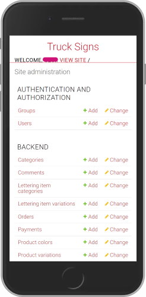
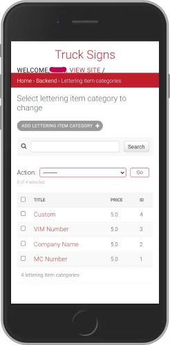
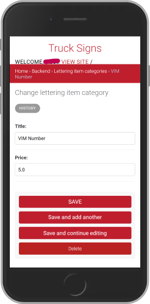
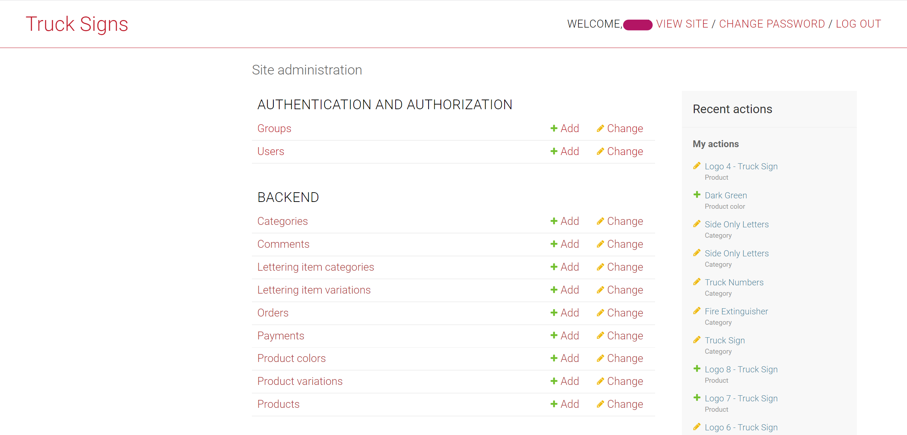
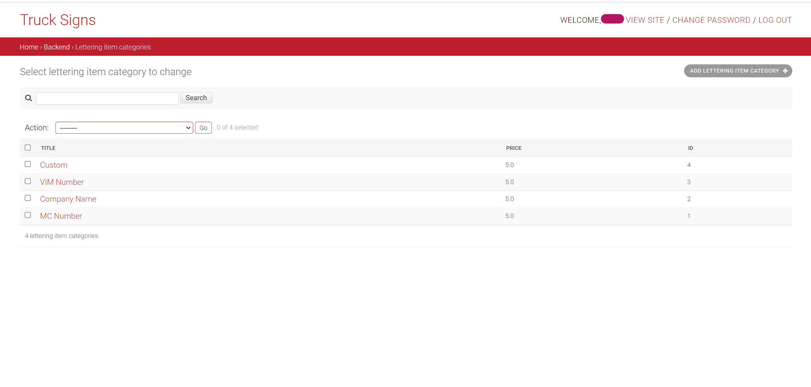
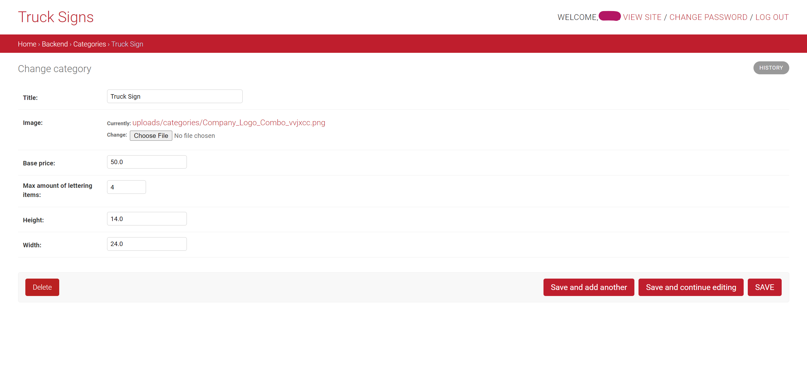

<div align="center">

# Signs for Trucks

  


__Signs for Trucks__ is an online store to buy pre-designed vinyls with custom lines of letters (often call truck letterings).
The store also allows clients to upload their own designs and to customize them on the website as well.

</div>

This repository holds the backend of the Signs for Trucks store: a Django application with a Django REST Framework API, served by gunicorn and backed by PostgreSQL. Its purpose is to run the API and its database as a reproducible Docker Compose stack (`Dockerfile`, `docker-compose.yml`, `entrypoint.sh`). The API is published on port `8020`. All files of the setup are listed under [Repository Files](#repository-files).

## Table of Contents

- [Signs for Trucks](#signs-for-trucks)
  - [Table of Contents](#table-of-contents)
  - [Prerequisites](#prerequisites)
  - [Quickstart](#quickstart)
    - [How to build the image](#how-to-build-the-image)
  - [Usage](#usage)
    - [Settings](#settings)
    - [Environment Variables](#environment-variables)
    - [Docker Compose](#docker-compose)
    - [Build the Container Image](#build-the-container-image)
    - [Run with docker run](#run-with-docker-run)
    - [Data Persistence](#data-persistence)
    - [Models](#models)
    - [Brief Explanation of the Views](#brief-explanation-of-the-views)
    - [Installation (without Docker)](#installation-without-docker)
  - [CI Pipelines](#ci-pipelines)
  - [Repository Files](#repository-files)
  - [Screenshots of the Django Backend Admin Panel](#screenshots-of-the-django-backend-admin-panel)
    - [Mobile View](#mobile-view)
    - [Desktop View](#desktop-view)
  - [Additional Information](#additional-information)
    - [Postgresql Database](#postgresql-database)
    - [Docker](#docker)
    - [Django and DRF](#django-and-drf)
    - [Miscellaneous](#miscellaneous)

## Prerequisites

* [Docker](https://docs.docker.com/get-docker/) with Docker Compose (needed for the Quickstart)
* [Git](https://git-scm.com/install/)
* [Python 3.12.x](https://www.python.org/downloads/) (only needed for the local installation without Docker)

## Quickstart

1. Clone the repo:
```bash
git clone git@github.com:bjoerndaigger/truck-signs-api.git
cd truck-signs-api
```

2. Copy the example file into a `.env` file and fill in all empty values. Never commit this file:
```bash
cp example.env .env
```

3. Build the image and start the stack:
```bash
docker compose up -d --build
```

4. Open the admin panel and log in with the superuser from your `.env` file:
```
http://localhost:8020/admin/
```
On a server, use `http://<SERVER_IP>:8020/admin/` and add the server address to `ALLOWED_HOSTS` in your `.env` file.

5. Stop the stack. The data is kept:
```bash
docker compose down
```

### How to build the image

```bash
docker build -t truck-signs-api:v2 .
```

`docker compose up -d --build` does this step automatically. More details are in [Build the Container Image](#build-the-container-image).

## Usage

### Settings

The `settings.py` file inside the `src/tsa_app` folder contains the different settings configuration for the application.

The `example.env` file in the project root contains an overview about configuration values that can be set for the app.

### Environment Variables

All variables are set in the `.env` file. Docker Compose passes them to the `backend` service (`env_file`) and uses `DB_NAME`, `DB_USER` and `DB_PASSWORD` to configure the `db` service. Replace the placeholders with your own values.

| Variable | Description | Example / Default |
|---|---|---|
| `MODE` | `prod` (default if unset) uses PostgreSQL, anything else uses SQLite | `prod` |
| `DEBUG_ENABLED` | `True` or `False`, keep `False` in production. `True` forces `MODE=dev` (SQLite) | `False` |
| `SECRET_KEY` | Django secret key | `<YOUR_SECRET_KEY>` |
| `ALLOWED_HOSTS` | Comma-separated list of allowed host names or IPs | `localhost,127.0.0.1` |
| `DB_NAME` | Database name | `<DB_NAME>` |
| `DB_USER` | Database user | `<DB_USER>` |
| `DB_PASSWORD` | Database password | `<DB_PASSWORD>` |
| `DB_HOST` | Name of the database service in the Compose network, not `localhost` | `db` |
| `DB_PORT` | Database port (optional) | `5432` |
| `DJANGO_SUPERUSER_USERNAME` | Username of the automatically created superuser | `<ADMIN_USERNAME>` |
| `DJANGO_SUPERUSER_EMAIL` | Email of the superuser | `<ADMIN_EMAIL>` |
| `DJANGO_SUPERUSER_PASSWORD` | Password of the superuser | `<ADMIN_PASSWORD>` |
| `CLOUD_NAME`, `CLOUD_API_KEY`, `CLOUD_API_SECRET` | Cloudinary credentials (optional) | `<CLOUDINARY_VALUE>` |
| `EMAIL_HOST_USER`, `EMAIL_HOST_PASSWORD` | Email credentials (optional) | `<EMAIL_VALUE>` |

### Docker Compose

`docker-compose.yml` defines two services in the same network (`tsa-network`):

- `db`: PostgreSQL (`postgres:18.7-alpine`). It has no published port, so it is only reachable from other containers in the network (the `backend` reaches it by the name `db`).
- `backend`: the Django app, built from the `Dockerfile` and published on port `8020`.

Common commands:

```bash
docker compose up -d --build   # build the image and start all services
docker compose logs -f backend # follow the logs of the app
docker compose ps              # show the status of the services
docker compose down            # stop and remove the containers (data is kept)
```

How the start works (`entrypoint.sh`):

1. Waits until the database accepts connections (`DB_HOST`, `DB_PORT`).
2. Runs `python manage.py collectstatic --noinput` and `python manage.py migrate`.
3. Creates the superuser from the `DJANGO_SUPERUSER_*` variables. If the user already exists, this step is skipped, so the container also starts on the second run.
4. Starts gunicorn (WSGI) on port `8020` with 4 workers.

How to change the result:

- **Other host port:** set `BACKEND_PORT=9000` in your `.env` file (default `8020`). The app is then available on port `9000`. The container itself always listens on `8020`.
- **Other number of gunicorn workers:** change `--workers 4` in the last line of `entrypoint.sh`, then rebuild with `docker compose up -d --build`.
- **Other PostgreSQL version:** change the image tag of the `db` service. Use a fixed tag, not `latest`.
- **Access from a server:** add its IP or domain to `ALLOWED_HOSTS` in the `.env` file.

### Build the Container Image

```bash
docker build -t truck-signs-api:v2 .
```

- `-t truck-signs-api:v2` sets the image name and tag. Use the same name as in `docker-compose.yml` (`image:`).
- The `Dockerfile` uses a fixed, slim Python base image, installs `requirements.txt`, makes `entrypoint.sh` executable and uses it as `ENTRYPOINT`.
- To use another Python version, change the tag in the `FROM` line of the `Dockerfile` (keep it a fixed 3.12.x slim tag).

### Run with docker run

Without Compose you have to start both containers yourself. Build the image first, see [Build the Container Image](#build-the-container-image). Replace the placeholders with your own values.

> [!NOTE]
> The containers use the same names (`tsa_db`, `tsa_backend`) as the Compose stack. Stop the stack with `docker compose down` before you run these commands.

```bash
# 1. Create a network so the containers can reach each other
docker network create tsa-network

# 2. Start the database (the alias "db" must match DB_HOST in your .env file)
docker run -d \
  --name tsa_db \
  --network tsa-network \
  --network-alias db \
  -e POSTGRES_DB=<DB_NAME> \
  -e POSTGRES_USER=<DB_USER> \
  -e POSTGRES_PASSWORD=<DB_PASSWORD> \
  -v postgres_data:/var/lib/postgresql \
  postgres:18.7-alpine

# 3. Start the app (all settings come from the .env file)
docker run -d \
  --name tsa_backend \
  --network tsa-network \
  --env-file .env \
  -p 8020:8020 \
  -v media_data:/app/src/mediafiles \
  truck-signs-api:v2
```

### Data Persistence

Two named volumes are used. Docker manages them, they are not linked to a folder on your computer:

- `postgres_data`: the database files (`/var/lib/postgresql` in the `db` container).
- `media_data`: uploaded media files (`/app/src/mediafiles` in the `backend` container).

The data stays after `docker compose down` and `docker compose up -d`.

> [!WARNING]
> `docker compose down -v` deletes the volumes and all data.

### Models

Most of the models do what can be inferred from their name. The following dots are notes about some of the models to make clearer their propose:
- __Category Model:__ The category of the vinyls in the store. It contains the title of the category as well as the basic properties shared among products that belong to a same category. For example, _Truck Logo_ is a category for all vinyls that has a logo of a truck plus some lines of letterings (note that the vinyls are instances of the model _Product_). Another category is _Fire Extinguisher_, that is for all vinyls that has a logo of a fire extinguisher.
- __Lettering Item Category:__ This is the category of the lettering, for example: _Company Name_, _VIM NUMBER_, ... Each has a different pricing.
- __Lettering Item Variations:__ This contains a foreign key to the __Lettering Item Category__ and the text added by the client.
- __Product Variation:__ This model has the original product as a foreign key, plus the lettering lines (instances of the __Lettering Item Variations__ model) added by the client.

### Brief Explanation of the Views

Most of the views are CBV imported from _rest_framework.generics_, and they allow the backend api to do the basic CRUD operations expected, and so they inherit from the _ListAPIView_, _CreateAPIView_, _RetrieveAPIView_, ..., and so on.

The behavior of some of the views had to be modified to address functionalities such as creation of order and payment, as in this case, for example, both functionalities are implemented in the same view, and so a _GenericAPIView_ was the view from which it inherits. Another example of this is the _UploadCustomerImage_ View that takes the vinyl template uploaded by the clients and creates a new product based on it.

### Installation (without Docker)

For development with a local SQLite database, without containers (Python 3.12.x required):

```bash
python -m venv .venv
source .venv/bin/activate        # Windows: .venv\Scripts\activate
pip install -r requirements.txt
cp example.env .env
```

In the `.env` file, set `MODE=dev` and a `SECRET_KEY` (any long random string). All other values can stay empty.

```bash
cd src
python manage.py migrate
python manage.py createsuperuser
python manage.py runserver
```

The development server listens on http://localhost:8000/. Running `makemigrations` is not needed, the migrations are part of the repository.

---

## CI Pipelines

The repository contains three GitHub Actions workflows in `.github/workflows/`:

| Workflow | File | Trigger | Purpose |
|---|---|---|---|
| Lint and Test Python Code Base | `test.yaml` | Push or pull request to `main`, only if `*.py` files or `requirements.txt` change | Job `lint` runs `flake8`, `black --check` and `isort --check-only`. Job `test` (after `lint`) runs `python manage.py test` in `src` with `MODE=dev` (SQLite) |
| Check open PR for feature branch | `check-open-pr.yaml` | Push to any branch except `main`, and when a pull request is opened | Fails if the branch has no open pull request |
| Build Application | `build.yaml` | Push of a tag, or manual start | Builds the Docker image and pushes it to `ghcr.io` with the tags `latest` and the tag name |

## Repository Files

| File | Description |
|---|---|
| `Dockerfile` | Builds the application image (Python 3.12 slim, installs dependencies, starts `entrypoint.sh`) |
| `docker-compose.yml` | Runs the `backend` and `db` services with named volumes for database and media files |
| `.dockerignore` | Keeps `.env`, the git history and local artefacts out of the Docker build context |
| `.gitignore` | Keeps `.env`, virtual environments and generated files out of version control |
| `entrypoint.sh` | Start script of the container (database wait, migrations, static files, superuser, gunicorn) |
| `example.env` | Template for the `.env` file with all configurable variables |
| `requirements.txt` | Python dependencies |
| `pyproject.toml` | Configuration for `black`, `isort` and `flake8` (used by the lint job in CI) |
| `Procfile` | Start command (`gunicorn`) for platforms that read a Procfile. Not used by the Docker setup, which starts gunicorn in `entrypoint.sh` |
| `docs/testing.md` | Documentation of linting and test tooling |
| `.github/workflows/` | CI workflows, see [CI Pipelines](#ci-pipelines) |
| `src/` | Django application |

## Screenshots of the Django Backend Admin Panel

### Mobile View

<div style="padding: 0 5rem; width: 100%;  display: flex; gap: 5rem; justify-content: center; flex-wrap: wrap;">







</div>

### Desktop View


<div style="padding: 0 5rem; width: 100%; display: flex; flex-direction: column; gap: 2rem; align-items: center; justify-content: center;">







</div>

## Additional Information

### Postgresql Database

- Setup Database: [Digital Ocean Link for Django Deployment on VPS](https://www.digitalocean.com/community/tutorials/how-to-set-up-django-with-postgres-nginx-and-gunicorn-on-ubuntu-16-04)

### Docker

- [Docker Oficial Documentation](https://docs.docker.com/)
- Dockerizing Django, PostgreSQL, guinicorn, and Nginx:
    - Github repo of sunilale0: [Link](https://github.com/sunilale0/django-postgresql-gunicorn-nginx-dockerized/blob/master/README.md#nginx)
    - Michael Herman article on testdriven.io: [Link](https://testdriven.io/blog/dockerizing-django-with-postgres-gunicorn-and-nginx/)

### Django and DRF

- [Django Official Documentation](https://docs.djangoproject.com/en/5.2/)
- Generate a new secret key: [Stackoverflow Link](https://stackoverflow.com/questions/41298963/is-there-a-function-for-generating-settings-secret-key-in-django)
- Modify the Django Admin:
    - Small modifications (add searching, columns, ...): [Link](https://realpython.com/customize-django-admin-python/)
    - Modify Templates and css: [Link from Medium](https://medium.com/@brianmayrose/django-step-9-180d04a4152c)
- [Django Rest Framework Official Documentation](https://www.django-rest-framework.org/)
- More about Nested Serializers: [Stackoverflow Link](https://stackoverflow.com/questions/51182823/django-rest-framework-nested-serializers)
- More about GenericViews: [Testdriver.io Link](https://testdriven.io/blog/drf-views-part-2/)

### Miscellaneous

- Create Virual Environment with Virtualenv and Virtualenvwrapper: [Link](https://docs.python-guide.org/dev/virtualenvs/)
- [Configure CORS](https://www.stackhawk.com/blog/django-cors-guide/)
- [Setup Django with Cloudinary](https://cloudinary.com/documentation/django_integration)